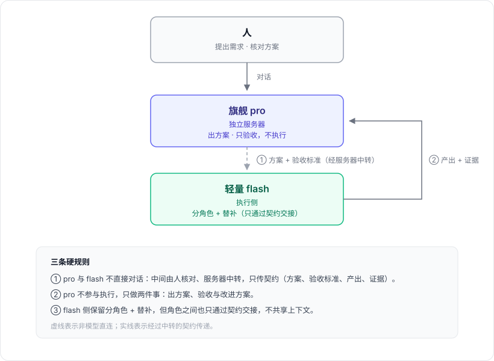

# 设计推理：为轻量模型而写，用隔离换确定性

> 这是 [README](README.md) 的展开。README 说明「这是什么、怎么跑」，本文件说明「为什么这么做」。
>
> 文中数字都是**单次实测读数**，不是跑分、也不是压测均值；哪一栏是账单读数、哪一栏是估算，
> 都标注了。没有留存账单的地方会明说。

## 设计前提：为轻量模型而写

这个项目服务的对象是公司里不懂技术的普通员工，所以模型档位不能按旗舰算：
它必须跑在便宜的轻量模型上，还要在真实任务里稳定可用。

直接接大模型做这套东西会漂——同一句话换个温度、换个措辞，边界判断就变了。
换旗舰能压住漂移，但成本撑不住；而**旗舰 + 轻量混用也不是省钱方案**：
轻量一旦卡住就由旗舰接管，上下文重建、缓存失效，总消耗反而高于全程旗舰，
两条路径的判断口径还会互相打架，方案越调越偏。

所以这套架构的取舍是：**把判断从模型手里移到代码里。**
模型只管生成，权限边界、验收判定、证据留存交给确定性代码。

仓库里那些闸门和测试，目的不是证明代码写对了，而是**让轻量模型也能满足员工的实际需求**。

## 实测：混用两档模型，比全程用贵的还贵

同一件活，三种跑法：

| 跑法 | 耗时 | 花费 |
|---|---|---|
| 全程轻量（flash） | 约 5 小时 | ¥4 |
| 全程旗舰（pro） | 约 1.5 小时 | ¥100+ |
| **flash + pro 混用** | 没跑完 | **≈¥300（约全程 pro 的 3 倍）** |

> 单次实测，非压测均值。前两行的 ¥4 / ¥100+ 是账单读数；混用那一栏没有留存账单，
> 按当时消耗估为 3 倍左右。耗时是墙钟时间。

混用最贵，而且贵得没道理——**问题不在模型，在它们互相看得见。**

机制是：两个模型各出一版，意见不一致时，弱的那个开始敷衍，强的那个发现不对就
接手整个任务重做。结果是两份成本都付了，还多了一次完整重做，上下文反复重建、缓存全废。

再往后试过「分角色 agent + 替补席」，能压到勉强可用，但幻觉和跑偏还在。
根因是同一个：**让两个模型互相对话，它们会互相污染上下文，而且没有人对结果负责。**

## 现在的做法：隔离，而不是协作



三条硬规则：

1. **pro 与 flash 不直接对话**。中间由人/服务器做中介，只传契约化的东西：方案、验收标准、产出、证据。
2. **pro 不参与执行**，只做两件事：出方案、验收与改进方案。
3. **flash 侧保留分角色 + 替补**，但角色之间也只通过契约交接，不共享上下文。

效果：幻觉和跑偏明显下降。原因很简单——**每个模型只对自己那一格负责，耦合被换成了契约。**

### 替补不是一种，是两种

第 3 条里那个「替补」，实际是两个完全不同职责的角色：

| 类型 | 什么时候动 | 输入从哪来 |
|---|---|---|
| **顶替型** | 某个执行角色卡死、或产出不合格 | 该角色的契约：目标、进度、已有证据 |
| **观测型** | 全程在场，一直盯着方向 | **pro 在立项时写好的检查清单** + 原始事实 |

关键在于观测型：**它不是「自己判断有没有跑偏」，而是「对照 pro 给的清单做封闭检查」。**

pro 在开工前就把规矩写死——查哪几项、注意什么、发现偏差按什么格式回传。这一步把
「开放判断」变成了「可机械执行的检查」，所以一个便宜模型也干得了。

两个失效模式必须防：

- **规矩漏项** ⇒ 观测者集体失明，而且失明得很安静（它在严格按规矩执行，不会报错）。
  对策：拿**已知会跑偏的历史案例**回放，看这套规矩抓不抓得住——等于给检查清单做变异测试。
- **规矩写成「需要判断」的话** ⇒ 弱模型执行不了。
  `注意方案是否偏离原目标` 抓不住任何东西；`检查产物里是否有 project.godot，没有就报 DRIFT` 才抓得住。

汇报只认固定字段，不写自然语言长报告：

```text
目标：<立项时的验收点>
实际：<观察到的事实>
偏差：有/无 + 一句差异
证据：<路径 / 命令输出>
```

理由：**一段话就是一段可漂移的生成物**，而字段可以被逐条核对。

### 为什么偏偏是「开头 + 结尾」这两个点

升级的代价和**已累积的上下文**成正比：越晚换 pro，要喂给它的历史越长，token 越贵。

所以最容易犯的错，是等 flash 卡死了再去请求 pro——那正是 ¥300 那一次的成因：
接手时上下文最大，还要从头重做一遍，两份成本都付。

反过来，pro 的两个介入点，恰好都是「输入可以很小」的位置：

| 介入点 | 喂给 pro 的东西 | 成本 |
|---|---|---|
| 开头定向 | 需求原文 | 小 |
| 结尾验收 | 产出 + 验收标准（**不是**全量上下文） | 小 |
| 中间执行 | 全量上下文 | **这一段不给 pro** |

一句话：**让贵的模型只出现在「输入小」的位置。**

这也是「pro 不参与执行」真正的理由——不是因为执行不重要，是因为执行阶段上下文长得最快，
把贵的模型放进去，等于按最贵的价格买最长的 prompt。

## 隔离之后的读数

同一类任务的横向对比（完工质量一栏是按产出人工判断，不是跑分）：

| 跑法 | 耗时 | 花费 | 成品 |
|---|---|---|---|
| 全程轻量（flash） | 约 5 小时 | ¥4 | 会漂，得人一直盯着 |
| 全程旗舰（pro） | 约 1.5 小时 | ¥100+ | 快，但**同样会漂**，而且没人拦 |
| 混用（同一上下文） | 没跑完 | ≈¥300 | 最差：两个模型互相打架 |
| **隔离架构（现在）** | 约 8 小时 | **≈¥10** | 不跑偏，会自我修正 |

注：最后一行的成品质量不含设计与图像类任务——那两类仍是旗舰的强项，轻量侧接不住。

**这里比较的不是「谁更聪明」。** 旗舰也会漂：单个模型无论多贵，长任务里照样会偏，
只是它偏得快、偏得贵。全程用旗舰真正的问题不是质量差，是**它既是执行者又是裁判**——
偏了没人发现，等发现时已经做完了一大半。

补一个观察：单看**分析质量**，pro 和 flash 其实差不了太多。差异集中在两步——**「定方向」和「做判断」**：

- pro 更快给出判断，而且在判断时**不容易被上下文里的旧信息带偏**；
- flash 在这两步上更慢，还会把混进来的脏数据当成有效依据，于是方向偏了、再回头纠正。

一旦方向定了、进到「做单件事」，两者的效率其实不分上下——执行阶段比的是工具用得熟不熟，
不是模型想得深不深。

换句话说：**pro 买的是「判断的收敛速度 + 抗干扰」，不是「更好的手艺」。**
这也正好解释了它为什么被放在「出方案 / 验收」两格，而不是执行格。

所以这套架构买到的不是「更聪明的模型」，而是**一条独立于执行的验收线**。
成本优势是副产品，确定性才是目的。

按这个差价（每次约省 ¥90）算，跑上一百来次，抵掉的是一台开发机的钱——
所以「多等几个小时」这件事，只在**有人站在旁边等**的时候才不划算。挂着跑的任务，
时间成本接近零，省下的就是净收益。

结论：**用约 10 块钱、8 小时，换一个「漂了会被抓住」的产出。**

它只适合一种场景：**时间不敏感、成本敏感**。员工提交任务后挂着跑，人只在「方案核对」
那一步介入一次。反过来，如果要求一小时出结果，这套架构不成立，直接上旗舰更划算。

—— 这也是这套设计能成立的前提：**公司里绝大多数活不需要实时，但每一分钱都要算。**

## 一条贯穿全仓的判据

这套东西在三个尺度上做的是同一件事——**把「互相影响」换成「各自对契约负责」**：

| 层次 | 耦合（有问题的做法） | 契约（现在的做法） |
|---|---|---|
| 模型之间 | pro 与 flash 互相看得见，打架、摆烂、接手重做 | 不直接对话，只传方案与证据 |
| 模型与代码 | 让 LLM 自己判断该不该写、算不算完成 | 判定移到 `intentGate` / 验收清单 |
| 人与人 | 需求模糊、责任不清 | 一页范围、验收标准、默认动作 |

具体到代码怎么分，只有一条判据：

> **能写成 `if` 的，写死进代码；写不成的，才留给验收。**

中间那一层用 schema 固化（技能 `manifest` 里的参数声明就是），既不是自然语言约定，
也不需要运行期判断。规则写死在提示词里是软的——它只是「请求模型遵守」，不是保证。

## 已知边界与未解问题

诚实登记，不当成待办清单来粉饰：

1. **设计与图像类任务接不住**。轻量侧在这两类上没有优势，别用这套去接。
2. **时间不敏感是前提**。要求一小时出结果时，直接上旗舰。
3. **「脏数据从哪来」尚未定位**。观察到的是现象：flash 在定方向、做判断时更容易被
   上下文里的旧信息带偏，pro 明显更少。但「是上下文污染、缓存前缀串味、还是单纯的判断力差异」，
   目前没有实验能区分。要定位，得做三路对比：同一任务分别给 flash / pro / 人工写好的方案，
   比「失败工具调用数 / 重规划次数」。
4. **验收判定里仍有模型参与**。`acceptanceChecklist` 已经是清单化 + 证据化，但
   「关键项缺证据就判未完成」这一档，标准仍由模型解释，这部分没有完全移进代码。

