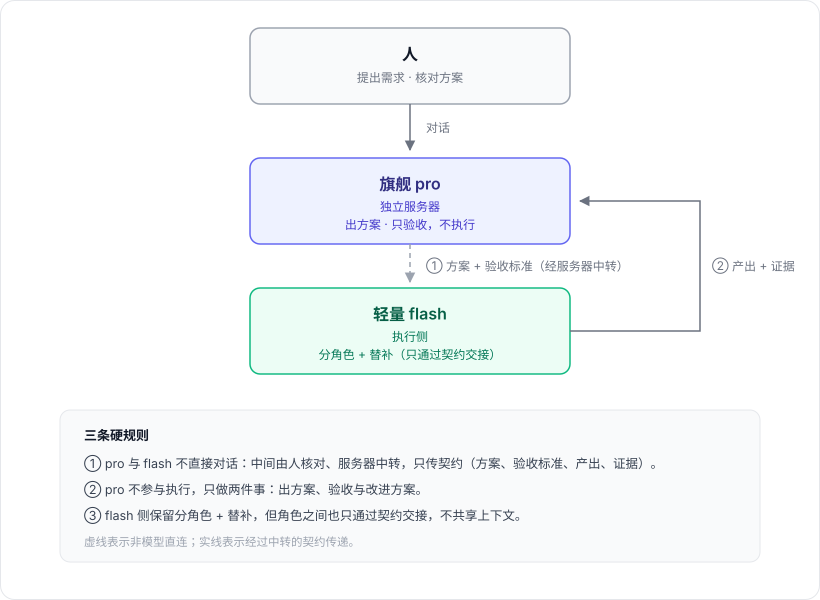

# 豆芽 CLAW（Douya CLAW）· 桌面 Agent 源码快照

一个从零写的 Electron + React + Node 桌面 Agent：流式对话、可插拔 LLM、工具协议与执行闸门、
交付验收、技能运行时、记忆、本地 Python 技能、自动更新。

这个仓库是**源码快照**（2026-11-12，版本 `0.21.34`），不是可一键运行的发行版：
发行用的二进制、运行时、内部部署脚本与数据都不在这里（见 [SANITIZATION.md](SANITIZATION.md)）。

## 一句话说清取舍

目标用户是公司里不懂技术的员工 ⇒ 只能跑得起轻量模型。
但轻量模型在**定方向**和**做判断**这两步会漂，所以把判断移进确定性代码，模型只负责生成；
贵的旗舰模型只在两个「输入最小」的位置出现——**开头定向、结尾验收**。



| 跑法 | 耗时 | 花费 | 成品 |
|---|---|---|---|
| 全程轻量（flash） | 约 5 小时 | ¥4 | 会漂，得人一直盯着 |
| 全程旗舰（pro） | 约 1.5 小时 | ¥100+ | 快，但同样会漂，没人拦 |
| 两档混用（同一上下文） | 没跑完 | ≈¥300 | 最差：互相打架 |
| **隔离架构** | 约 8 小时 | **≈¥10** | 不漂，会自我修正 |

> 单次实测读数，非压测均值；混用一栏为估算（无账单留存）。设计与图像类任务接不住。

推理过程、废弃方案、观测契约和已知边界都在 **[DESIGN.md](DESIGN.md)**。

## 这一版包含什么

- **Agent 主循环与工具协议**：`src/main/backend.js`、`toolProtocol.js`、`workflowRunner.js`
- **意图与交付授权门**：`src/main/intentGate.js`（含 0.21.34 的 `artifact-save` 修复：
  用户说「把 X 存成 Word/PDF/文件」时不再被误判成「只读调查」而拦死写文件）
- **交付验收**：`acceptanceChecklist.js`、`acceptanceReadings.js`、`deliveryProtocol.js`、
  `runtimeEvidence.js`、`evidenceQuality.js`
- **技能运行时**：`skills/`（文件、文档、图片、视频等技能，Python/Node 混编）
- **记忆与人格**：`memoryStore.js`、`memoryExtractor.js`、`douyaPersona.js`
- **桌面外壳**：`src/main/main.js`、`preload.js`、`src/renderer/`（React 界面）、
  `src/renderer-pet/`（桌宠窗口）
- **项目规则**：`AGENTS.md`（多 Agent 协作、门禁与验收纪律）

## 跑起来（开发模式）

需要 Node.js ≥ 18（本快照按 Node 20/22 验证过构建）。

```bash
npm install
npm run build:renderer      # 构建主界面与桌宠的渲染层
npm run dev:app             # 启动 Electron（需要本地图形环境）
```

配置从 `.env.example` 复制成 `.env`，填入你自己的 LLM Key。默认走 OpenAI 兼容接口，
示例是 DeepSeek；也可换任意兼容网关。

**Python 技能**：`skills/` 里的 Python 技能需要 `resources/python-runtime`（未包含，约 455MB）。
可以自行放一份 Python 3 到该路径，或改技能入口调用系统 Python。

## 目录

```text
src/main/          Electron 主进程：Agent 循环、工具协议、门禁、验收、记忆、更新
src/renderer/      主窗口 React 界面
src/renderer-pet/  桌宠窗口
src/shared/        主进程与渲染层共用的契约
skills/            技能实现（manifest + run.js / run.py）
build/             打包资源（图标等）
docs/images/       设计文档里的图
AGENTS.md          项目内的工程与验收规则
DESIGN.md          设计推理：为什么是轻量模型 + 隔离架构
overview.md        产品概览
```

## 关于 0.21.34

这一版只改了一处：`src/main/intentGate.js` 新增 `artifact-save` 判据。
修复的真实故障是：用户说「把这份诊断报告存成 Word 文件」时，意图门把它判成
「只读调查」+「未授权」，于是写文件被拦死，而验收又要求必须有产物——死锁。
独立抽出的最小实现与 11 条测试在另一个仓库：
[chickenboy-jyc/agent-intent-gate](https://github.com/chickenboy-jyc/agent-intent-gate)。

## 不包含什么

- `node_modules/`、`dist/`、`release/`（构建产物与安装包）
- `python-runtime/`（Python 发行版）
- 部署/发布脚本（含内部服务器与凭据，**已刻意排除**）
- 内部设计文档、需求原文、验收报告（含业务信息）
- 测试与测试夹具（体积大且夹带内部路径）
- 任何客户数据、数据库、日志、抓取产物

## 迭代取舍与已废弃方案

下面几条都是**被淘汰的思路**。写在这里不是记流水账，而是说明当前每个机制各在兜什么：
每一条都对应一个「单跑看着能用、批量跑就崩」的方案，和替代它的确定性机制。

| 被淘汰的方案 | 根本缺陷 | 现在的做法 |
|---|---|---|
| 靠系统提示词约束 LLM 自行区分只读 / 写入 | 约束上限低：温度、措辞、上下文一变就漂；边界场景越权且不可审计 | 独立的确定性意图闸 `intentGate.js`，规则显式编码，不依赖模型自觉 |
| 只做简单重试，没有熔断 | 下游接口持续异常、模型连续幻觉时触发重试风暴，任务越堆越多，最后雪崩 | `workflowRunner.js` 里加失败计数、熔断与降级分支 |
| 由 LLM 自己判断任务是否交付完成 | 会虚报完成：说「已交付」，但拿不出可核验的产出 | 独立验收协议 + 证据采集 + 证据质量校验，完成判定从模型手里拿走 |
| 闸门一刀切，拦住所有写文件操作 | 与「任务本来就要求产出交付物」冲突，安全策略和业务目标互相死锁 | 按意图分档判定（`artifact-save` 等判据），只有明确要求产出时才放行写盘 |

这四条的共同点：**它们最后都不是靠「把提示词写得更好」解决的，而是把判断从模型手里移到代码里。**

LLM 负责生成；边界、证据、判定交给确定性代码。这是这个仓库最基本的取舍——
不是让模型更聪明，而是**在模型不稳定这个前提下，让系统仍然可审计、可收敛**。

判据、代价与未解问题见 [DESIGN.md](DESIGN.md)。

## 文档

| 文件 | 内容 |
|---|---|
| `README.md` | 这是什么、包含什么、怎么跑 |
| [`DESIGN.md`](DESIGN.md) | 为什么这么设计：实测读数、隔离架构、观测契约、已知边界 |
| [`AGENTS.md`](AGENTS.md) | 多 Agent 协作、门禁与验收纪律 |
| [`SANITIZATION.md`](SANITIZATION.md) | 这个快照删掉了什么、为什么 |
| [`overview.md`](overview.md) | 产品概览 |

## License

MIT，见 [LICENSE](LICENSE)。第三方服务（模型 API、货源站点等）的使用请自行遵守其条款。

## 免责声明

这是从真实产品里导出的**归档快照**，按「现状」提供，不承诺可完整复现生产行为：
部分模块依赖作者自己的后端、账号与私有配置。请把它当参考实现，而不是开箱即用的产品。
